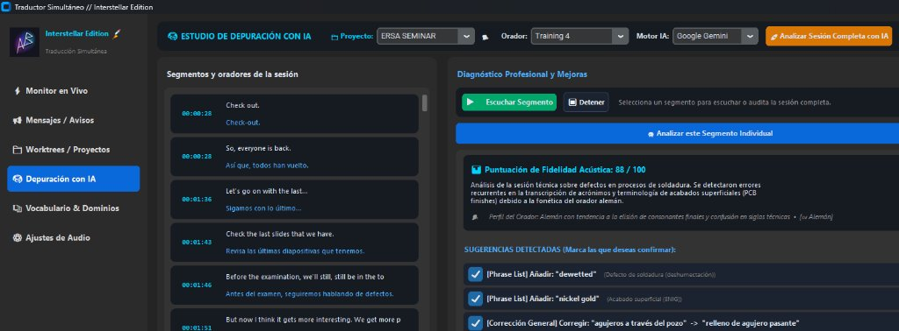
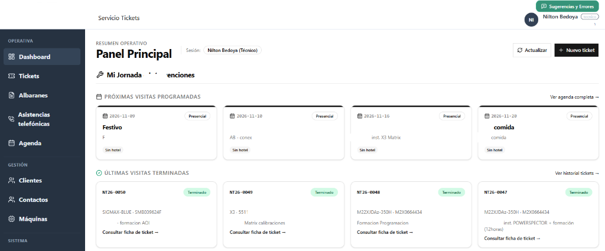
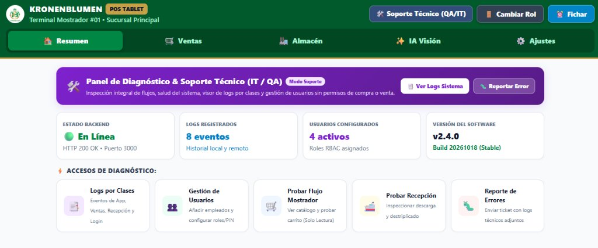
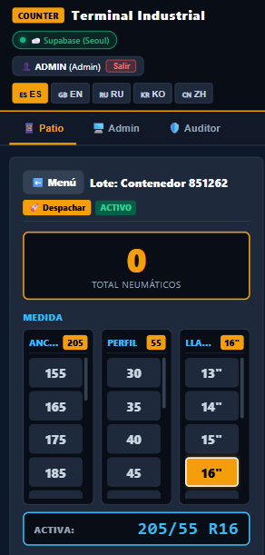
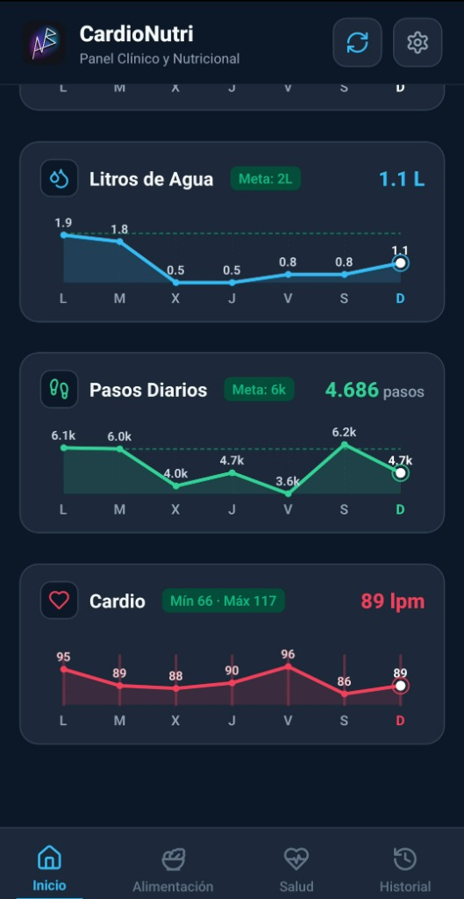
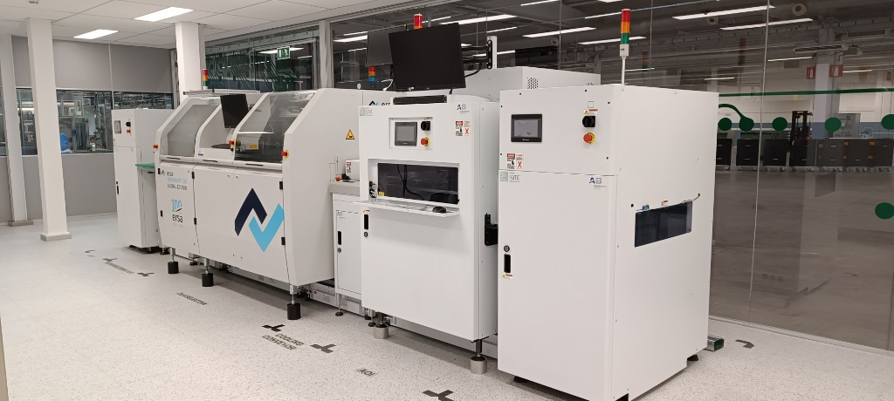
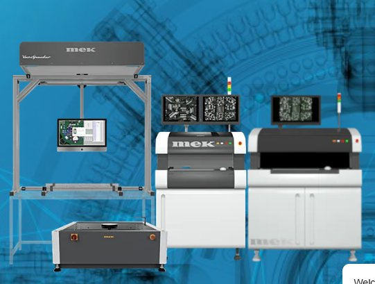
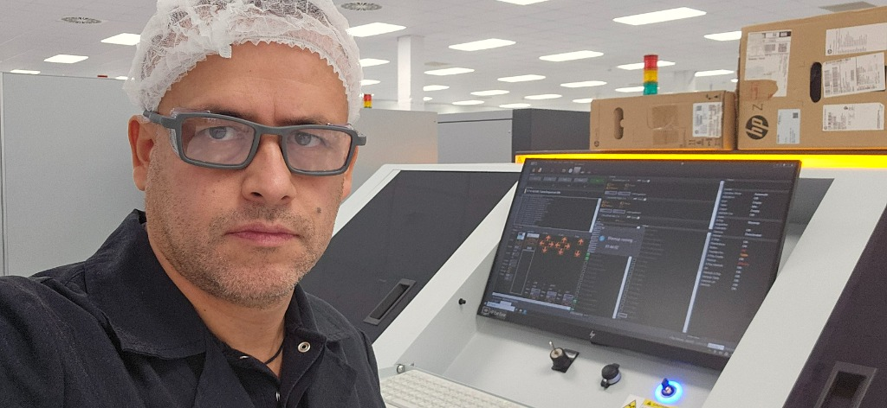

# Showcase Platform — Living Technical Portfolio

[](https://github.com/niltonbedoya/PersonalWebpage/actions/workflows/ci-cd.yml)
[](#roadmap-fases-bajo-gentle-ai)
[](#matriz-de-agentes-runtime)
[](https://portfolio.services-nba.com/)

Portfolio técnico híbrido en producción para un perfil de doble especialización:
**Ingeniería SMT/THT (Inspección Óptica 3D, Rayos X, Soldadura, Handling)** y
**Arquitectura de Software Industrial & Soluciones AI**.

🌐 **Acceso público en producción:** [https://portfolio.services-nba.com/](https://portfolio.services-nba.com/)

---

## Capturas de Pantalla & Casos de Estudio

### Desarrollo de Software & Soluciones AI

| Traducción Simultánea en Vivo (Interstellar AI) | Dashboard Operativo de Tickets Técnicos |
|:---:|:---:|
|  |  |
| **Pipeline AI de baja latencia con depuración en tiempo real** | **SaaS de servicio técnico con SLAs y trazabilidad** |

| Kronenblumen POS & ERP Industrial | COUNTER Terminal Industrial (Visión AI) | CardioNutri Telemetría IoT |
|:---:|:---:|:---:|
|  |  |  |
| **Panel de soporte QA/IT y facturación** | **Conteo y packing list de exportación** | **Monitoreo biométrico y telemetría clínica** |

### Ingeniería Electrónica SMT/THT & Automatización

| ERSA Versaflow 3/45 (Soldadura Selectiva) | Inspección Óptica 3D AOI (Mek / Marantz) | Inspección Rayos X AXI (Matrix) |
|:---:|:---:|:---:|
|  |  |  |
| **Soldadura selectiva mini-wave con nitrógeno N2** | **Inspección óptica de componentes SMD y uniones** | **Inspección no destructiva de soldaduras BGA/QFN** |

---

## Arquitectura dual: dos jerarquías de agentes

Una cosa es **cómo se construye** el proyecto y otra es **lo que la app
ejecuta en producción**. Nunca se mezclan:

```
CAPA DE CONSTRUCCIÓN (build-time)              CAPA DE PRODUCTO (runtime)
--- Gentle-AI — metodología ---                --- FastAPI multiagente ---

  Orquestador ODD  ─ delega ─►  Explorador            Nexus (orquestador FSM)
        │                         Worker        ┌─ Radarito  (feeds noticias)
        ├─ planifica en odd/      Verificador   ├─ Cerebrito (motor RAG)
        ├─ TDD Red→Green→Refactor               ├─ Centinela (guardrail)
        └─ work-unit commits                    ├─ Mensajerito(triage leads)
                                                └─ Auditor   (QA binaria)
```

| | Build-time (Gentle-AI) | Runtime (producto) |
|---|---|---|
| Propósito | Construir y verificar el código | Operar la web desplegada |
| Agentes | Orquestador, explorador, worker, verificador | Nexus, Radarito, Cerebrito, Centinela, Mensajerito, Auditor |
| Planificación | `odd/<feature>.md` (Specs/Tasks/Log) | Contratos Pydantic v2 congelados |
| LLM | N/A (procesos de desarrollo) | Zero-cost routing: Groq / Google AI Studio / Cloudflare / OpenRouter Free |

La capa de construcción no genera código de producto y la de producto no
decide planificación: la separación es la regla crítica documentada en
`AGENTS.md`.

## Qué construye el producto

- **Patrón Hub & Spoke**: Hub Central (`/`) + Spoke Industrial
  (`/industrial-smt`) + Spoke Software (`/software-engineering`).
- **Runtime multiagente** FastAPI: un orquestador (Nexus), cuatro subagentes
  especializados y un auditor transversal (compuerta Pass/Fail).
- **Diamond funcional**: guardrail perimetral `< 150 ms` (Centinela), RAG con
  `grounding_score >= 0.85` sobre corpus local SQLite-vec (Cerebrito), feeds
  curados en 3 canales (Radarito), triage de leads con alerta cifrada sin
  exponer el correo (Mensajerito), auditoría de todas las salidas (Auditor).
- **Frontend Astro** (SSG + Islands), WebSockets en tiempo real
  (`/ws/{agent_name}`), formulario con honeypot, y CV/LinkedIn/GitHub.
- **Zero-cost routing de LLM** entre proveedores de free tier según la tarea.

## Arranque rápido

```powershell
cd D:\PersonalAIFolder\PersonalWebPage
python -m backend.main
```

- Backend: http://localhost:8000
- Hub: http://localhost:8000/static/pages/index.html
- Spoke Industrial: http://localhost:8000/static/pages/industrial-smt.html
- Spoke Software: http://localhost:8000/static/pages/software-engineering.html
- Swagger: http://localhost:8000/api/docs

> Nota Windows: la consola es cp1252 — los logs del servidor usan ASCII
> solamente.

## Endpoints (runtime)

- `GET  /health` — estado global + agentes activos
- `POST /chat` — chat orquestado por Nexus (guardrail → RAG → auditoría)
- `GET  /news` — feed RSS curado por Radarito, actualizado diariamente a
  las 08:00 (`Europe/Madrid`) con caché persistente y respaldo offline
- `POST /contact` — formulario seguro (honeypot + antispam)
- `WS   /ws/{agent_name}` — canal en tiempo real por agente

## Estructura del repositorio

```
web/                  # Frontend Astro (SSG + Islands)
  public/pages/       # HTML de Hub & Spokes servidos en /static/pages/
backend/              # Runtime multiagente FastAPI
  app/agents/         # Nexus, Radarito, Cerebrito, Centinela, Mensajerito, Auditor
  app/models.py       # 5 contratos Pydantic v2 (firmas congeladas)
  app/mcp/adapters.py # Adaptadores MCP de dominio por agente
  app/routers/        # /chat /news /contact /health
  tests/              # Suite TDD (contratos, mocks LLM, resiliencia)
data/                 # Corpus técnico sanitizado y datasets de prueba
docs/                 # Especificaciones fuente (SDD/TDD)
odd/                  # Feature docs ODD — plan de construcción, no código
```

## Matriz de agentes (runtime)

| Agente       | Rol                              | Modelo (costo cero)                          |
|--------------|----------------------------------|----------------------------------------------|
| Nexus        | Orquestador central & router FSM | Selección de proveedor gratuito por tarea    |
| Radarito     | Curación de noticias (3 canales) | Cloudflare Workers AI / OpenRouter Free      |
| Cerebrito    | Motor RAG técnico (SQLite-vec)   | Google AI Studio (`gemini-flash`)            |
| Centinela    | Guardrail & seguridad (<150 ms)  | Groq (`llama-3.1-8b-instant`)                |
| Mensajerito  | Triage & despacho de leads       | Groq (`llama-3.1-8b-instant`)                |
| Auditor      | QA binaria Pass/Fail             | Google AI Studio (grounding ≥ 0.85)          |

## Stack

Astro 4 + Tailwind + Lucide (frontend SSG) · Python 3.12 + FastAPI + Pydantic v2
(backend) · SQLite + SQLite-vec (RAG local) · Engram MCP (memoria de agentes) ·
Context7 MCP (docs dinámica) · Cloudflare Pages (hosting edge) · pytest + Vitest
+ Playwright (TDD).

## Roadmap (fases bajo Gentle-AI)

| Fase | Alcance | Estado |
|---|---|---|
| F1 | Contratos Pydantic v2 con tests Red→Green | ✅ Completada (13 tests) |
| F2 | 6 agentes runtime contra mocks deterministas | ✅ Completada (104 tests) |
| F3 | API (/chat /news /contact /health) + WebSockets | ✅ Completada (182 tests) |
| F4 | Frontend Hub & Spoke + feeds + drawer RAG | ✅ Completada (201 tests) |
| F5 | Corpus sanitizado + indexado SQLite-vec | ✅ Completada (387 tests) |
| F6 | Resiliencia: 67 vectores anti-inyección, veredictos Auditor | ✅ Completada (441 tests) |
| F7 | Hardening, Rate Limiting, Deploy Mac Mini + Cloudflare Edge | ✅ Completada (455 tests en verde) |

El proyecto cuenta con una suite completa de **455 tests automatizados pasando al 100%**, ejecutándose en cada commit mediante el pipeline de GitHub Actions desplegado en producción continua.

## Referencias

- `docs/prompt_maestro_de_inicio.md` — prompt maestro SDD/TDD: topología,
  contratos y estructura de directorios.
- `docs/especificaci_n_y_resumen_de_arquitectura.md` — visión del producto,
  alcance funcional, stack y estrategia TDD.
- `docs/plan_de_fases_verificacion.md` — matriz F1–F7: tests y auditorías
  obligatorias por fase, estado y criterios de salida.
- `AGENTS.md` — contexto obligatorio para agentes de código (separación
  build-time/runtime, convenciones y roadmap).
- `odd/` — feature docs ODD de cada fase.
